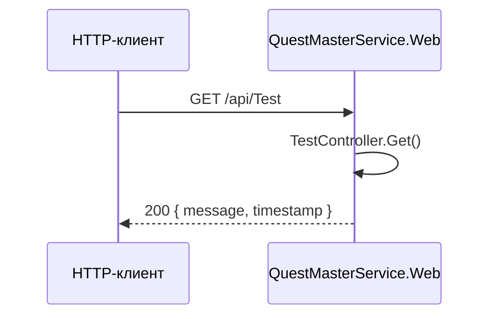

# Потоки данных

## Реализованный HTTP-поток

Контроллер создаёт ответ непосредственно в памяти. Вызовов Core, Domain, Infrastructure или БД нет.

## Доменные потоки (не подключены к HTTP/API)

Код позволяет в памяти:

1. Создать `Test`, добавить `Text`/`Match`/`Option` question.
2. Создать `Attempt` по `testId` и `userId`.
3. Добавить соответствующие ответы до завершения попытки.
4. Завершить попытку с неотрицательным total score.

Это не является работающим пользовательским потоком: создание right answer для `TextQuestion` через `Test.AddQuestion` сейчас завершается ошибкой (см. [решения](../decisions/architecture-decisions.md)). Данные не сохраняются и не передаются через API.
