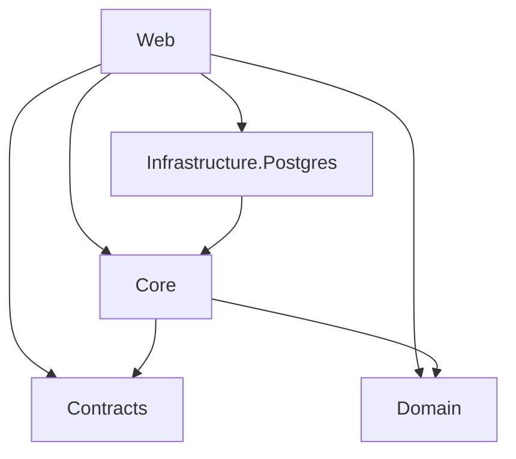

# Сервисы и проектные границы

## QuestMasterService

**Статус:** единственный реализованный deployable сервис. Его зона ответственности пока ограничена запуском Web API и хранением в коде доменной модели тестирования. Имя `QuestMasterService` используется всеми проектами solution.

### Направление зависимостей

`Web` напрямую ссылается на все остальные проекты, включая Domain и Contracts. Это фактическая graph-зависимость, а не вывод об использовании всех слоёв: `Program.cs` не регистрирует Core/Infrastructure и не использует доменные типы.

### Слои

- **Domain:** тестирование: `User`, `Test`, `Question` и его варианты, `Attempt`, `Answer` и value objects. Подробнее — [Backend / QuestMasterService](../backend/services/quest-master-service.md).
- **Contracts:** файлов исходного кода нет; публичные DTO или межсервисные контракты не определены.
- **Core:** файлов исходного кода нет; commands/queries, handlers, validators и порты отсутствуют.
- **Infrastructure.Postgres:** `DbContext`, entities/configurations, migrations, repositories и connection settings отсутствуют.
- **Web:** `Program.cs` и `TestController`; endpoints перечислены в [API](../api/endpoints.md).

## Границы контекстов

Явных bounded contexts нет. По namespace и связям модели можно осторожно выделить один кандидат на контекст — «Тестирование»: тесты, вопросы, варианты, попытки и ответы. `User` представлен отдельной сущностью без аутентификации, профиля или связи с хранилищем; самостоятельный User/Identity context кодом не установлен.
