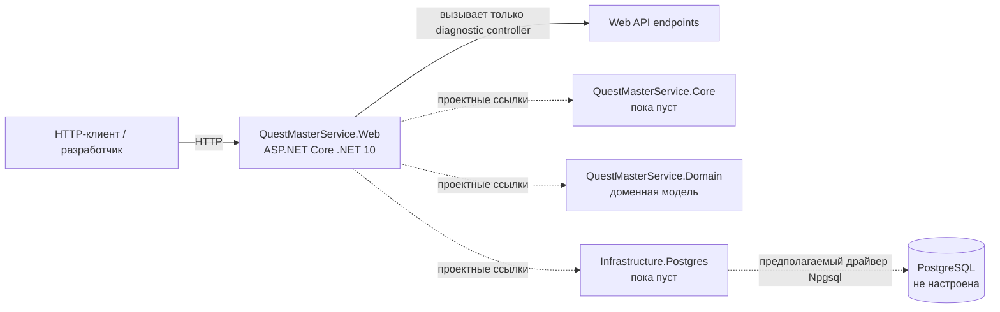

# Контекст системы

В коде нет внешних систем, клиентов или межсервисных протоколов. Единственный внешний вход — HTTP-клиент, обращающийся к одному ASP.NET Core приложению. PostgreSQL фигурирует только как намерение через package references, поэтому на диаграмме отмечен пунктиром.

## Внешние зависимости

| Зависимость | Подтверждённое использование |
| --- | --- |
| ASP.NET Core / .NET 10 | Web host, controller routing, health checks, OpenAPI. |
| Scalar.AspNetCore | UI API reference в non-production. |
| CSharpFunctionalExtensions | Результаты фабрик и доменных методов. |
| EF Core, Npgsql, Dapper | Только package references в проекте инфраструктуры. |
| FluentValidation, Scrutor | Только package references в Core. |

Нет подтверждений вызовов другого сервиса, message broker, HTTP client, cache, файлового хранилища, identity provider или базы данных.
